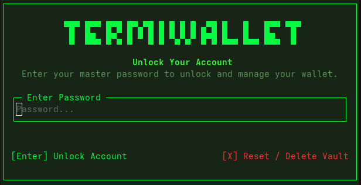
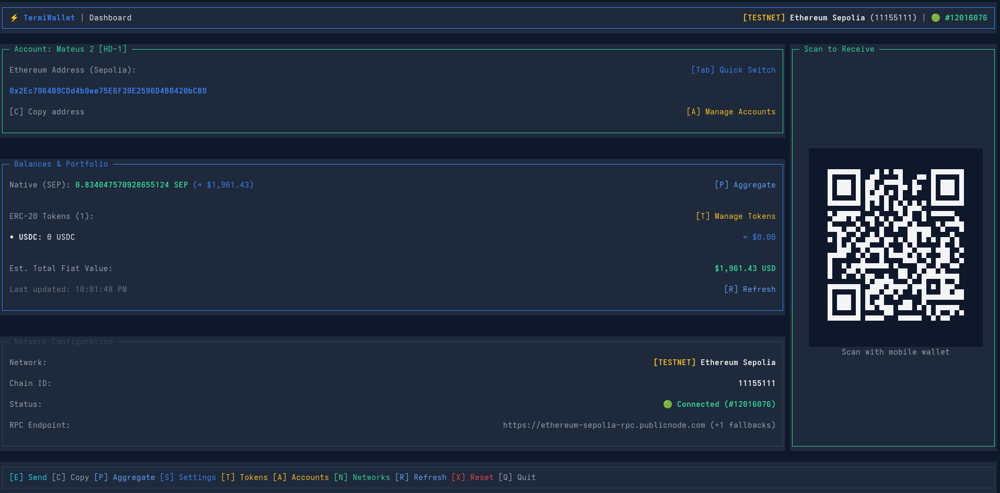
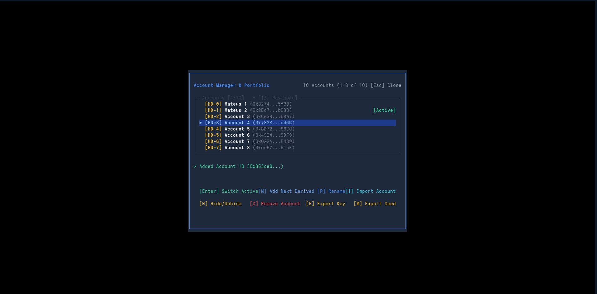

<p align="center">
  
</p>

<h1 align="center">TermiWallet</h1>

<p align="center">
  <strong>Non-custodial Ethereum wallet for your terminal.</strong><br>
  A fast, keyboard-driven Text User Interface (TUI) built with Bun, TypeScript, and OpenTUI React.
</p>

<p align="center">
  <a href="https://bun.sh"></a>
  <a href="https://www.typescriptlang.org/"></a>
  <a href="https://react.dev/"></a>
  <a href="https://ethereum.org/"></a>
  <a href="https://viem.sh/"></a>
  <a href="https://github.com/opentui/opentui"></a>
</p>

---

## Overview

**TermiWallet** is a feature-complete Ethereum wallet that runs entirely within the terminal as an interactive Text User Interface (TUI). Designed for developers and power users who value speed and keyboard workflow, TermiWallet enables managing multiple HD accounts, tracking portfolios and ERC-20 tokens, switching EVM networks, and dispatching transactions without leaving the terminal.

> [!IMPORTANT]
> TermiWallet is strictly **non-custodial**. Your private keys and BIP-39 recovery phrases are generated, encrypted, and stored locally on your machine. They are never sent to external servers.

---

## Key Features

- 🔑 **Account & Key Management**
  - BIP-39 mnemonic generation (12 or 24 words) with interactive backup verification.
  - Hierarchical Deterministic (HD) derivation following BIP-44 (`m/44'/60'/0'/0/n`).
  - Import wallets via seed phrase, raw private key, or encrypted JSON keystore file (Web3 Secret Storage v3).
  - Support for watch-only accounts, custom local labels, and account hiding.
  - Password-protected export for private keys and recovery phrases.

- 🛡️ **Vault Security**
  - Encrypted at rest using **AES-256-GCM** with **PBKDF2** key derivation.
  - Strict filesystem permissions (`0600`) enforced for the local vault file.
  - Real-time password strength meter and quick vault reset capabilities.

- 💸 **Send & Receive Transfers**
  - Guided send stepper with real-time balance validation and recipient address checking.
  - Dynamic gas estimation compliant with **EIP-1559** (Base Fee + Priority Fee).
  - Transfer native ETH and configured ERC-20 tokens.
  - Receive screen with interactive **in-terminal QR code rendering** and instant clipboard copying (supporting native clipboards and OSC 52 fallback).

- 🌐 **Multi-Network & Portfolio Tracking**
  - Built-in support for Ethereum Mainnet and Sepolia Testnet.
  - Custom EVM network manager (RPC endpoint, Chain ID, currency symbol, and block explorer).
  - Automatic network latency, block height, and health checks.
  - Live USD balance conversion with individual account or aggregated portfolio views.

- 🎨 **Visuals & Custom Theming**
  - Responsive fullscreen layout built on OpenTUI React with ASCII FIGlet branding.
  - Pre-configured color themes: *Termi Dark*, *Dracula*, *Cyberpunk*, *Nord*, *Monokai*, and *Matrix*.
  - Seamless navigation driven entirely by keyboard shortcuts.

---

## Screenshots

<p align="center">
  
  &nbsp;
  
</p>

---

## Getting Started

### Prerequisites

- [Bun](https://bun.sh/) (v1.1 or later recommended)
- A terminal with Truecolor / ANSI support (e.g., Ghostty, Alacritty, iTerm2, Kitty, Windows Terminal)

### Installation

Clone the repository and install dependencies using Bun:

```bash
git clone https://github.com/MateusNavarro77/ethereum-wallet-cli.git
cd ethereum-wallet-cli
bun install
```

### Running TermiWallet

Start the terminal UI:

```bash
bun run start
```

On first launch, you will be prompted to create a new encrypted vault or import an existing wallet.

---

## Keyboard Shortcuts (Dashboard)

Every action in the dashboard can be triggered via keyboard hotkeys:

| Key | Action |
|:---:|---|
| <kbd>E</kbd> | Open the transaction sender modal (*Send*) |
| <kbd>C</kbd> | Copy active account address to clipboard |
| <kbd>A</kbd> | Accounts manager (switch, add, import, export, rename, hide) |
| <kbd>N</kbd> | Networks manager (switch network, add custom EVM RPC) |
| <kbd>T</kbd> | Tokens manager (add and toggle ERC-20 tokens) |
| <kbd>P</kbd> | Toggle between active account and aggregated portfolio view |
| <kbd>R</kbd> | Refresh balances, fiat prices, and network status |
| <kbd>S</kbd> | Settings modal (color theme selection) |
| <kbd>[</kbd> / <kbd>]</kbd> | Cycle to previous / next visible account |
| <kbd>X</kbd> | Reset vault (requires explicit confirmation) |
| <kbd>Q</kbd> | Quit application |

---

## Environment Variables

You can customize paths and network endpoints using environment variables:

| Variable | Default | Description |
|---|---|---|
| `TERMIWALLET_HOME` | `~/.termiwallet` | Directory path where the encrypted vault file is stored. |
| `SEPOLIA_RPC_URL` | Public node endpoint | Custom JSON-RPC endpoint URL for the Sepolia network. |

> [!TIP]
> For test automation or isolated sessions, point `TERMIWALLET_HOME=/tmp/test-vault` to run without modifying your primary wallet.

---

## Development & Testing

TermiWallet uses strict TypeScript checks and includes unit and integration tests:

```bash
# Run the complete test suite
bun test

# Run a specific test file
bun test tests/services/wallet.test.ts

# Type-check without emitting files
bun run typecheck
```

---

## Architecture

TermiWallet follows an Inversion of Control (IoC) pattern powered by a lightweight dependency injection container (`src/container/`):

- **`src/core/`**: Domain models, service contracts (`interfaces.ts`), and typed service tokens.
- **`src/services/`**: UI-independent core services (cryptography, HD wallet derivation, filesystem vault storage, RPC, and transactions).
- **`src/ui/`**: OpenTUI React presentation layer consisting of screens, reusable components, theme providers, and state hooks.
